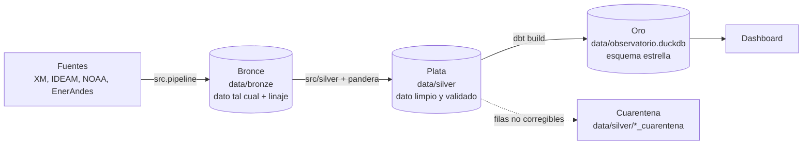
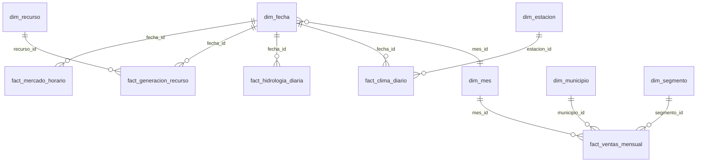

# Observatorio Energía y Clima – Equipo <nombre>

> Proyecto Integrado IV – Integración de Información · IU Digital de Antioquia · 2026-2

## Integrantes

| Nombre | Usuario GitHub | Rol |
|---|---|---|
| | | Líder técnico / Data Engineer |
| | | Data Quality Analyst |
| | | Analytics Engineer |
| | | BI Analyst / Storyteller |

## Objetivo

Integrar datos del mercado eléctrico (XM), del clima (IDEAM y NOAA) y de ventas internas (EnerAndes) para analizar el riesgo energético de Colombia ante El Niño 2026.

## Fuentes de datos (capa bronce)

| Fuente | Tipo | Archivo en `data/bronze/` |
|---|---|---|
| XM – API Sinergox | API REST (POST, JSON) | `xm_precio_bolsa`, `xm_demanda`, `xm_generacion`, `xm_embalses`, `xm_aportes`, `xm_recursos` |
| IDEAM – datos.gov.co | API Socrata (SoQL) | `ideam_precipitacion_diaria`, `ideam_temperatura_diaria` |
| NOAA – índice ONI | Archivo de texto | `noaa_oni` |
| EnerAndes | Excel interno | `enerandes_ventas_2023` … `enerandes_ventas_2026` |

## Arquitectura



| Capa | Qué contiene | Dónde se construye |
|---|---|---|
| Bronce | Los datos tal como llegaron, con las columnas de linaje `_fuente`, `_origen` y `_extraido_en`. | `src/extract/` |
| Plata | Una tabla limpia por fuente, validada con pandera. Las filas que no se pueden corregir van a un archivo de cuarentena. | `src/silver/` y `src/quality/` |
| Oro | Esquema estrella con 5 hechos y 6 dimensiones, probado con dbt. | `dbt/` |

## Cómo ejecutar

Requiere Python 3.11 o superior.

```powershell
python -m venv .venv
.\.venv\Scripts\Activate.ps1
python -m pip install -r requirements.txt
# copiar ventas_enerandes_2023_2026.xlsx en data/insumos/
python -m src.pipeline          # descarga las fuentes a data/bronze/
python -m src.transformar       # construye las capas plata y oro con un solo comando
python -m src.consultar         # ejecuta las consultas de consultas/oro/
python -m pytest                # pruebas de las reglas de limpieza
```

`python -m src.transformar` limpia todas las fuentes y valida cada tabla con pandera, escribe `docs/reporte_calidad.md`, ejecuta `dbt build` y regenera `docs/diccionario_datos.md`. Los datos de `data/silver/` y el archivo `.duckdb` no se suben a GitHub: se regeneran con ese comando.

Para volver a descargar las fuentes: `python -m src.pipeline --forzar`. El rango de fechas se cambia en `src/config.py`; el calendario de `dim_fecha` se cambia en `dbt/dbt_project.yml` (variables `fecha_inicio` y `fecha_fin`).

## Reporte de calidad

El reporte completo, con una tabla por fuente, está en [`docs/reporte_calidad.md`](docs/reporte_calidad.md). Lo genera el código a partir de las métricas que mide cada programa de limpieza (32 reglas en total). Resumen de lo que pasó de bronce a plata:

| Fuente | Tabla | Filas en bronce | Filas en plata | Filas en cuarentena |
|---|---|---:|---:|---:|
| EnerAndes | enerandes_ventas (4 hojas) | 4,184 | 4,007 | 43 |
| XM | xm_precio_bolsa | 273 | 6,552 | 0 |
| XM | xm_demanda | 273 | 6,552 | 0 |
| XM | xm_generacion | 126,314 | 1,978,304 | 1,053,232 |
| XM | xm_embalses | 273 | 273 | 0 |
| XM | xm_aportes | 273 | 273 | 0 |
| XM | xm_recursos | 2,512 | 2,509 | 0 |
| IDEAM | ideam_precipitacion | 2,784 | 2,779 | 5 |
| IDEAM | ideam_temperatura | 1,708 | 1,708 | 0 |
| NOAA | noaa_oni | 921 | 921 | 0 |

Las tablas de XM por hora crecen en plata porque cada fila de bronce trae 24 columnas (Hour01 a Hour24) y en plata queda una fila por fecha y hora. Los motivos de cada fila en cuarentena están en el reporte. El IDEAM solo publica datos hasta el 26 de julio de 2026: las semanas siguientes llegaron vacías desde la fuente.

Detalle de EnerAndes, que une las 4 hojas del Excel (4,184 filas en bronce, 4,007 en plata y 43 en cuarentena):

| # | Problema | Regla aplicada | Antes | Después |
|---|---|---|---:|---:|
| 1 | Nombres de columna distintos entre hojas | Mapear cada encabezado a un nombre estándar | 26 | 7 |
| 2 | Filas de título y notas antes del encabezado | Ubicar la fila de encabezados y descartar lo anterior | 6 | 0 |
| 3 | Filas de totales | Eliminarlas | 4 | 0 |
| 4 | Fechas en formatos distintos a AAAA-MM | Convertir mmm-aa, MM/AAAA y DD/MM/AAAA a AAAA-MM | 2704 | 0 |
| 5 | Fecha de corte día/mes/año (hoja 2026) | Leer el segundo número como mes, no como día | 834 | 0 |
| 6 | Energía en MWh mezclada con kWh | Multiplicar por 1000 para dejar todo en kWh | 347 | 0 |
| 7 | Segmento escrito de varias formas | Unificar a 3 valores | 6 | 3 |
| 8 | Segmento vacío | Marcarlo como 'No informado' | 29 | 0 |
| 9 | Tipo de compra escrito de varias formas | Unificar a Bolsa y Contrato | 4 | 2 |
| 10 | Municipio escrito de varias formas | Unificar con el nombre oficial y el código DIVIPOLA | 32 | 15 |
| 11 | Filas duplicadas | Dejar una sola copia | 120 | 0 |
| 12 | Energía vacía | Pasar la fila a cuarentena | 25 | 0 |
| 13 | Energía negativa | Pasar la fila a cuarentena | 18 | 0 |
| 14 | Valor facturado vacío | Dejarlo vacío y documentarlo | 28 | 28 |

Las 43 filas en cuarentena tienen energía vacía o negativa: no hay forma de reconstruir el consumo real sin inventarlo, así que se conservan en `data/silver/enerandes_cuarentena.parquet` con su hoja de origen y su motivo.

## Modelo dimensional

Esquema estrella con 5 hechos (`fact_ventas_mensual`, `fact_mercado_horario`, `fact_generacion_recurso`, `fact_hidrologia_diaria`, `fact_clima_diario`) y 6 dimensiones (`dim_fecha`, `dim_mes`, `dim_municipio`, `dim_segmento`, `dim_recurso`, `dim_estacion`). El grano de cada hecho está en [`docs/modelo_dimensional.md`](docs/modelo_dimensional.md), y las columnas de cada tabla en [`docs/diccionario_datos.md`](docs/diccionario_datos.md).



## Consultas sobre la capa oro

Las consultas están en `consultas/oro/` y se ejecutan con `python -m src.consultar`. Los resultados siguientes salen de las ventas de EnerAndes (2026 llega hasta septiembre).

**1. ¿Cuánta energía vendió EnerAndes cada año y qué peso tiene cada segmento?** (`01_energia_por_anio_y_segmento.sql`)

| anio | segmento | energia_gwh | facturado_miles_de_millones_cop | pct_del_anio |
|---:|---|---:|---:|---:|
| 2023 | Residencial | 309.7 | 266.8 | 42.9 |
| 2023 | Industrial | 231.4 | 188 | 32.1 |
| 2023 | Comercial | 169.6 | 167.5 | 23.5 |
| 2023 | No informado | 10.4 | 9.8 | 1.4 |
| 2024 | Residencial | 313.1 | 295.7 | 42.5 |
| 2024 | Industrial | 245.5 | 218.3 | 33.3 |
| 2024 | Comercial | 177.2 | 190 | 24.1 |
| 2024 | No informado | 0.8 | 0.8 | 0.1 |
| 2025 | Residencial | 334.5 | 346.8 | 43.4 |
| 2025 | Industrial | 251.6 | 244.7 | 32.7 |
| 2025 | Comercial | 181.8 | 217.1 | 23.6 |
| 2025 | No informado | 2.7 | 3 | 0.4 |
| 2026 | Residencial | 260.6 | 290 | 43.8 |
| 2026 | Industrial | 192.1 | 201.6 | 32.3 |
| 2026 | Comercial | 141 | 182.4 | 23.7 |
| 2026 | No informado | 1.5 | 1.6 | 0.2 |

El segmento residencial concentra cerca del 43 % de la energía en todos los años, seguido por el industrial (32 % a 33 %). Las filas sin segmento no pasan del 1,4 % de la energía.

**2. ¿Qué municipios concentran las ventas y a qué tarifa media se factura?** (`02_tarifa_por_municipio.sql`)

| municipio | energia_gwh | tarifa_media_cop_kwh |
|---|---:|---:|
| Medellín | 1,245.3 | 1,004 |
| Bello | 317.9 | 1,005 |
| Itagüí | 239.9 | 1,002 |
| Envigado | 209 | 1,002 |
| Rionegro | 150.1 | 1,003 |
| Sabaneta | 110.9 | 1,005 |
| Apartadó | 98.8 | 1,002 |
| Turbo | 73.1 | 1,009 |
| Caldas | 61.6 | 1,002 |
| La Estrella | 61.6 | 1,003 |

Medellín vende casi cuatro veces la energía de Bello, el segundo municipio. La tarifa media es casi igual en todos los municipios, alrededor de 1.000 COP/kWh.

**3. ¿Qué parte de la energía se compra en bolsa frente a contrato y a qué tarifa?** (`03_bolsa_vs_contrato_por_anio.sql`)

| anio | tipo_compra | energia_gwh | pct_energia_del_anio | tarifa_media_cop_kwh |
|---:|---|---:|---:|---:|
| 2023 | Bolsa | 159 | 22.1 | 880 |
| 2023 | Contrato | 559.5 | 77.9 | 880 |
| 2024 | Bolsa | 162 | 22.1 | 961 |
| 2024 | Contrato | 570.3 | 77.9 | 963 |
| 2025 | Bolsa | 171.1 | 22.2 | 1,054 |
| 2025 | Contrato | 598.6 | 77.8 | 1,055 |
| 2026 | Bolsa | 130.4 | 22 | 1,140 |
| 2026 | Contrato | 462.7 | 78 | 1,139 |

La compra en bolsa se mantiene en 22 % de la energía todos los años, y la tarifa media por kWh sube cada año de 880 a 1.140 COP.

**4. ¿Cómo cambia el precio de bolsa según la fase del fenómeno de El Niño?** (`04_precio_bolsa_por_fase_enso.sql`)

| fase_enso | dias | precio_bolsa_promedio_cop_kwh | precio_bolsa_maximo_cop_kwh | demanda_promedio_gwh_hora |
|---|---:|---:|---:|---:|
| El Niño | 153 | 693 | 1,847 | 10.20 |
| Neutral | 120 | 208 | 1,175 | 9.74 |

En los 153 días clasificados como El Niño el precio de bolsa promedió 693 COP/kWh, más del triple de los 208 COP/kWh de los 120 días Neutral. Es una comparación dentro de 2026, y los dos grupos corresponden a épocas distintas del año, así que no prueba por sí sola que la fase sea la causa.

**5. ¿Cuánta energía genera cada tipo de planta?** (`05_generacion_por_tipo_de_planta.sql`)

| tipo_recurso | plantas | generacion_gwh | pct_del_total |
|---|---:|---:|---:|
| HIDRAULICA | 153 | 47,528.3 | 71.5 |
| TERMICA | 71 | 12,935.5 | 19.5 |
| SOLAR | 372 | 5,229.4 | 7.9 |
| COGENERADOR | 12 | 647.2 | 1.0 |
| EOLICA | 3 | 155.2 | 0.2 |
| NO CATALOGADO | 1 | 4.5 | 0.0 |

La generación hidráulica aporta cerca del 72 % de la energía y la térmica cerca del 20 %. Una planta aparece en generación pero no en el catálogo de recursos de XM, por eso queda como NO CATALOGADO.


