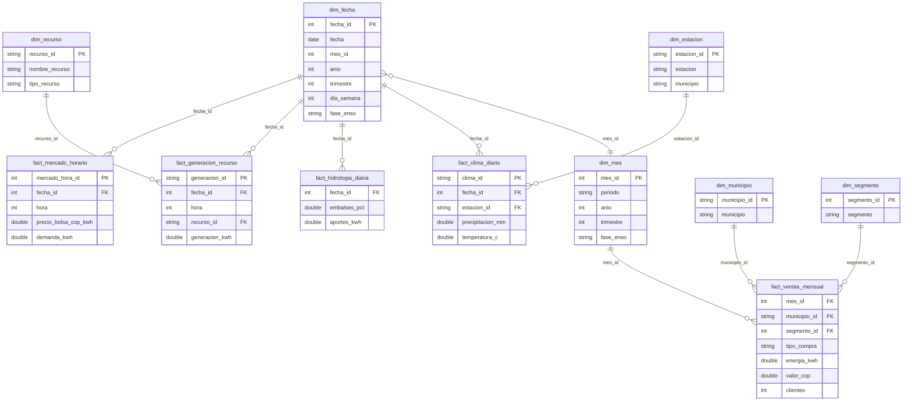

# Modelo dimensional

La capa oro es un esquema estrella construido con dbt sobre DuckDB (`data/observatorio.duckdb`). Tiene cinco tablas de hechos y seis dimensiones. `dim_fecha` es la dimensión compartida: lleva la fase ENSO de cada mes y se une con todos los hechos que tienen una fecha.

## Diagrama

## Grano de cada tabla de hechos

| Hecho | Grano | Medidas | Dimensiones |
|---|---|---|---|
| `fact_ventas_mensual` | Un mes, un municipio, un segmento y un tipo de compra (Bolsa o Contrato). Cubre de enero de 2023 a septiembre de 2026. | `energia_kwh`, `valor_cop`, `clientes` | `dim_mes`, `dim_municipio`, `dim_segmento` |
| `fact_mercado_horario` | Una hora de un día en el sistema interconectado nacional. | `precio_bolsa_cop_kwh`, `demanda_kwh` | `dim_fecha` |
| `fact_generacion_recurso` | Una planta de generación en una hora de un día. | `generacion_kwh` | `dim_fecha`, `dim_recurso` |
| `fact_hidrologia_diaria` | Un día. | `embalses_pct`, `aportes_kwh` | `dim_fecha` |
| `fact_clima_diario` | Una estación del IDEAM en un día. | `precipitacion_mm`, `temperatura_c` | `dim_fecha`, `dim_estacion` |

## Decisiones del modelo

- **Ventas por mes y mercado por hora son hechos separados.** Tienen granos distintos (mes contra hora), así que no se mezclan en una sola tabla. Se cruzan por `dim_fecha.mes_id` o por `dim_mes`, que comparten la fase ENSO.
- **`tipo_compra` se deja en el hecho de ventas.** Solo tiene dos valores y no tiene atributos propios, por eso no se creó una dimensión.
- **`dim_mes` sale de `dim_fecha`.** Así el mes de las ventas y el día de los hechos horarios usan la misma fase ENSO.
- **`dim_recurso` incluye las plantas que no están en `ListadoRecursos`.** Si una planta genera pero no aparece en el catálogo, entra con el tipo `NO CATALOGADO` y `en_catalogo = false`. Así `fact_generacion_recurso` no pierde filas y la prueba `relationships` de dbt sigue siendo estricta.
- **`dim_estacion` y `dim_municipio` son independientes.** El IDEAM entrega el municipio como texto y EnerAndes usa el código DIVIPOLA; no hay un código común para unirlos sin inventar equivalencias.
- **Los meses sin ONI quedan con `fase_enso = 'Sin dato'`.** NOAA publica el índice con retraso, y esos meses no se clasifican por suposición.
- **El calendario se define con las variables `fecha_inicio` y `fecha_fin` de `dbt/dbt_project.yml`.** Una fecha de un hecho fuera de ese rango hace fallar la prueba `relationships` hacia `dim_fecha`.
